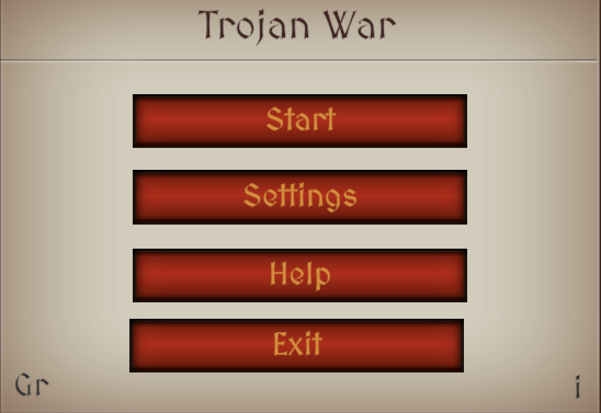
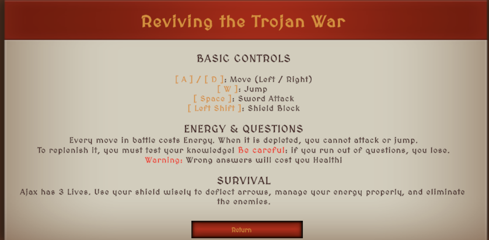
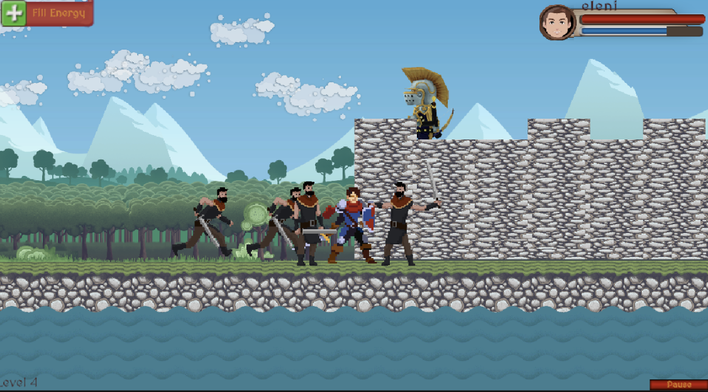
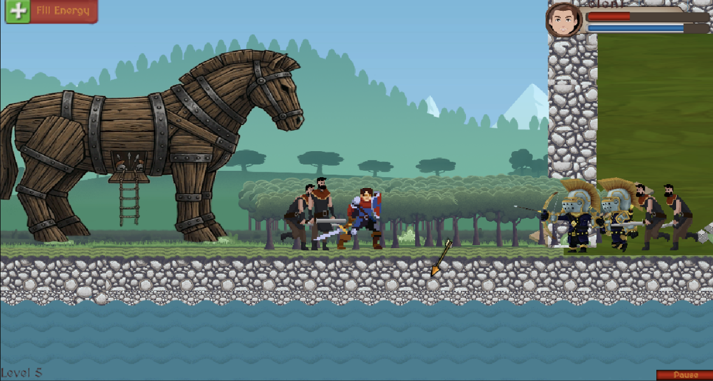

### **Reviving the Trojan War** · <small>Αναβιώνοντας τον Τρωικό Πόλεμο</small>

A 2D educational action-adventure game built with **Unity** and **C#** set during the Trojan War. Designed for primary school students, 
it combines exploration, stamina/health mechanics, and interactive history quizzes with bilingual support (English / Greek).

## Play the Game

- ** [Play in Unity Play] [https://play.unity.com/en/games/4ad0b35c-3786-4bac-ae06-2a26811fa637/trojanwar]
- ** [Play in itch.io] [https://elsidiryo.itch.io/reviving-the-trojan-war]

### Screenshots

  
  

  
  

## Key Features

- **Narrative & Progression:** Multi-level 2D adventure across key moments of the Trojan War.
- **Interactive Assessment:** Embedded history questions reinforcing comprehension during gameplay.
- **Bilingual Support:** Toggleable English and Greek text/localization.
- **Gameplay Mechanics:** Movement, combat/stamina/health systems, checkpoints, and UI feedback.

## Project Structure

- `Assets/` — Scenes, C# scripts, prefabs, sprites, audio, and localization data.
- `Packages/` — Unity package manifest and dependencies.
- `ProjectSettings/` — Unity project and build configuration.

## Academic Context

Developed as part of an MSc in Applied Informatics research project at the University of Macedonia (*Reviving the Trojan War: Design and evaluation of the educational value of a game for primary school students*).
